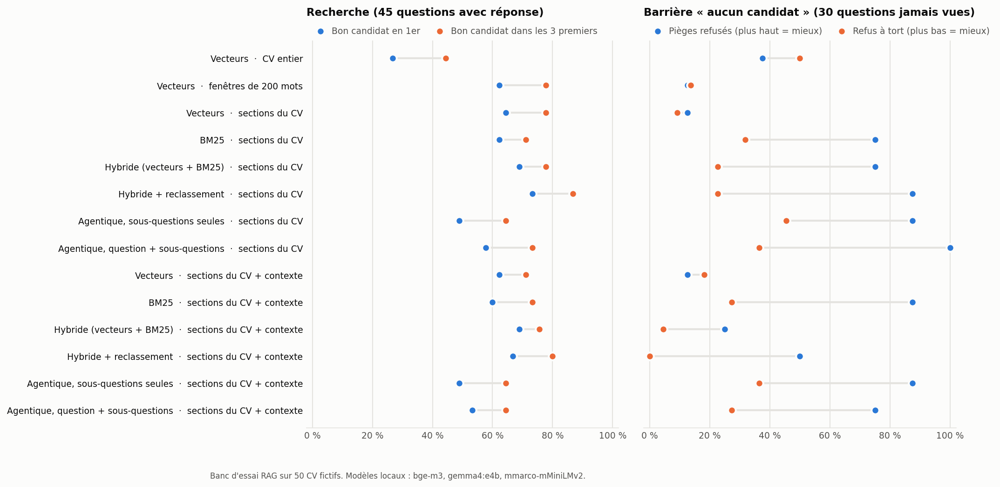

# rag-recrutement-bench

[](https://github.com/frejoyal/rag-recrutement-bench/actions/workflows/verification.yml)

> **Entreprise, candidats et CV fictifs.** Recrutement Élite inc. n'existe pas. Les 50 candidats, leurs employeurs et leurs CV sont inventés ; seules les villes sont réelles.
>
> **Fictional company, candidates and résumés.** See the [English section](#english).

Un banc d'essai qui compare 14 façons de chercher dans des CV avec un système RAG. Deux questions guident la comparaison : la méthode trouve-t-elle le bon candidat, et sait-elle répondre « personne » quand aucun candidat ne correspond ? Tout tourne en local, avec des modèles ouverts, et chaque résultat publié se recalcule à l'identique à chaque modification du dépôt.



## Le mandat

Recrutement Élite inc., un cabinet de recrutement québécois, veut un assistant qui répond aux questions des recruteurs sur sa banque de CV : « qui a la certification AZ-700 ? », « une développeuse mobile de Magog qui a travaillé en accessibilité ». L'assistant doit trouver le bon CV, même quand la question est formulée autrement que dans le CV. Il ne doit pas proposer un candidat au hasard quand personne ne correspond. Avant de choisir une architecture, le cabinet veut des mesures.

## Le corpus

- **50 CV longs** (1 100 à 1 500 mots) dans huit spécialités : infonuagique, données, cybersécurité, web, IA, gestion de produit, DevOps et mobile. Ils sont générés localement par `gemma4:e4b` avec [donnees/generer_cv.py](donnees/generer_cv.py), à partir des profils de [donnees/profils.py](donnees/profils.py).
- **Trois détails à retrouver par CV** : une certification, un projet dirigé et un engagement personnel. Chaque détail doit apparaître mot pour mot dans son CV et dans aucun autre. Un CV qui ne passe pas les contrôles est régénéré. Un seul a dû l'être, une fois.
- **Des contrôles à la génération** : les trois détails sont présents, aucun vrai employeur n'est nommé (les employeurs viennent d'une liste fictive), aucune coordonnée n'apparaît, et la longueur est vérifiée.

## Les questions

60 questions, dans [evaluation/questions.json](evaluation/questions.json) :

| Type | Nombre | Exemple | Ce qui est testé |
|---|--:|---|---|
| Sigle | 15 | « certification Azure AZ-700 en réseau » | un terme exact, rare |
| Paraphrase | 15 | « traduire la météo dans une langue autochtone du Nord » | le sens, sans les mots du CV |
| Anglais | 5 | « churn prediction for a fitness club » | une question dans une autre langue que le CV |
| Enfoui | 5 | « qui joue de la cornemuse » | une phrase isolée au milieu d'un long CV |
| Plusieurs critères | 5 | « spécialiste DevOps de Lévis certifiée Red Hat » | une ville, un métier et un détail en même temps |
| Piège | 15 | « spécialiste SAP S/4HANA » | personne ne correspond : la bonne réponse est de refuser |

Aucun terme des questions pièges n'apparaît dans les CV. Certains en sont proches, ce qui rend le test réaliste : des CV mentionnent Cisco, mais aucun la certification CCNP.

## Les méthodes

Chaque méthode classe les 50 candidats ; un candidat reçoit le meilleur score de ses passages.

- **Découpage.** Le CV entier en un seul vecteur, des fenêtres de 200 mots qui se chevauchent de 40 mots, ou une section par titre du CV.
- **Vecteurs.** Similarité cosinus avec `bge-m3` (multilingue).
- **BM25.** Recherche par mots, sans accents ni mots vides, qui garde les sigles entiers (AZ-700).
- **Hybride.** Fusion des deux classements par rangs réciproques (RRF, k = 60).
- **Reclassement.** Le modèle `mmarco-mMiniLMv2-L12-H384-v1` (cross-encoder multilingue) relit les 30 meilleurs passages de l'hybride face à la question.
- **Agentique.** Le modèle de langage découpe la question en sous-questions, chacune passe par l'hybride reclassé, puis les classements sont fusionnés. Deux versions : sous-questions seules, ou question entière plus sous-questions.
- **Préfixes contextuels** (*Contextual Retrieval*). Avant l'indexation, le modèle de langage écrit une ou deux phrases qui situent chaque section dans son CV (nom, domaine, ville, sujet). Cela coûte 442 appels au modèle, une fois.

**La barrière « aucun candidat ».** Chaque méthode refuse de répondre quand le score de son premier candidat est sous un seuil. Le seuil est calibré sur les questions impaires et mesuré sur les questions paires, que la calibration n'a jamais vues (22 avec réponse, 8 pièges). L'exactitude compte les bonnes décisions : le bon candidat en premier sans refus, ou un refus pour une question piège.

## Résultats

| Technique | Découpage | Contexte | 1er | 3 premiers | Pièges refusés | Refus à tort | Exactitude | Appels LLM | Passages reclassés |
|---|---|:-:|--:|--:|--:|--:|--:|--:|--:|
| Vecteurs | CV entier |  | 27 % | 44 % | 38 % | 50 % | 20 % | 0 | 0 |
| Vecteurs | fenêtres de 200 mots |  | 62 % | 78 % | 12 % | 14 % | 43 % | 0 | 0 |
| Vecteurs | sections du CV |  | 64 % | 78 % | 12 % | 9 % | 53 % | 0 | 0 |
| BM25 | sections du CV |  | 62 % | 71 % | 75 % | 32 % | 63 % | 0 | 0 |
| Hybride (vecteurs + BM25) | sections du CV |  | 69 % | 78 % | 75 % | 23 % | 77 % | 0 | 0 |
| **Hybride + reclassement** | **sections du CV** |  | **73 %** | **87 %** | **88 %** | **23 %** | **77 %** | 0 | 30 |
| Agentique, sous-questions seules | sections du CV |  | 49 % | 64 % | 88 % | 46 % | 60 % | 1 | 84 |
| Agentique, question + sous-questions | sections du CV |  | 58 % | 73 % | 100 % | 36 % | 70 % | 1 | 112 |
| Vecteurs | sections du CV | oui | 62 % | 71 % | 12 % | 18 % | 40 % | 0 | 0 |
| BM25 | sections du CV | oui | 60 % | 73 % | 88 % | 27 % | 67 % | 0 | 0 |
| Hybride (vecteurs + BM25) | sections du CV | oui | 69 % | 76 % | 25 % | 4 % | 53 % | 0 | 0 |
| Hybride + reclassement | sections du CV | oui | 67 % | 80 % | 50 % | 0 % | 67 % | 0 | 30 |
| Agentique, sous-questions seules | sections du CV | oui | 49 % | 64 % | 88 % | 36 % | 60 % | 1 | 84 |
| Agentique, question + sous-questions | sections du CV | oui | 53 % | 64 % | 75 % | 27 % | 63 % | 1 | 112 |

« 1er » et « 3 premiers » portent sur les 45 questions qui ont une réponse. Les trois colonnes suivantes portent sur les 30 questions paires. Les coûts sont des moyennes par question. Le détail de chaque méthode, dont les trois premiers candidats pour chaque question, est dans [resultats/resultats.json](resultats/resultats.json).

### Ce qu'on en retient

1. **Le découpage compte plus que tout le reste.** Un vecteur par CV entier ne trouve le bon candidat que 27 % du temps : un détail de deux lignes se perd dans 1 300 mots. Avec les mêmes vecteurs, découper par section fait passer ce taux à 64 %.
2. **Les vecteurs seuls ne savent pas dire non.** Leurs scores sont trop proches d'une question à l'autre pour placer un seuil : ils ne refusent que 12 % des pièges. Les scores de BM25 et du modèle de reclassement séparent beaucoup mieux une vraie correspondance d'une fausse.
3. **La meilleure combinaison est l'hybride reclassé sur les sections** : 73 % au premier rang, 87 % dans les trois premiers, 88 % des pièges refusés. Son coût : 30 passages relus par question, sans appel au modèle de langage.
4. **Les préfixes contextuels n'ont pas aidé sur ce corpus.** Ils aident les questions à plusieurs critères, puisqu'ils ajoutent la ville et le métier à chaque section. Mais ils noient les détails précis, et ils rapprochent les scores des bonnes et des mauvaises réponses : la barrière de l'hybride et du reclassement refuse beaucoup moins de pièges. Les préfixes générés restent assez génériques (« ce passage détaille ses compétences techniques »).
5. **La version agentique fait moins bien, pour plus cher.** Le modèle découpe aussi des questions qui n'ont qu'un critère, et certains morceaux n'ont plus de sens seuls : « quand il fait très froid », « parents ». Ajouter la question entière aux sous-questions corrige une partie du problème (de 49 % à 58 % au premier rang), sans rattraper l'hybride reclassé. Les deux versions sont publiées telles quelles.

<details>
<summary>Premier rang par type de question</summary>

| Méthode | Sigle | Paraphrase | Anglais | Enfoui | Plusieurs critères |
|---|--:|--:|--:|--:|--:|
| Vecteurs · CV entier | 20 % | 20 % | 0 % | 40 % | 80 % |
| Vecteurs · fenêtres de 200 mots | 60 % | 67 % | 20 % | 80 % | 80 % |
| Vecteurs · sections du CV | 67 % | 67 % | 40 % | 80 % | 60 % |
| BM25 · sections du CV | 67 % | 40 % | 40 % | 100 % | 100 % |
| Hybride · sections du CV | 67 % | 67 % | 40 % | 100 % | 80 % |
| Hybride + reclassement · sections du CV | 73 % | 73 % | 60 % | 60 % | 100 % |
| Agentique, sous-questions seules · sections du CV | 53 % | 33 % | 40 % | 40 % | 100 % |
| Agentique, question + sous-questions · sections du CV | 67 % | 33 % | 60 % | 60 % | 100 % |
| Vecteurs · sections + contexte | 60 % | 60 % | 40 % | 60 % | 100 % |
| BM25 · sections + contexte | 67 % | 40 % | 20 % | 100 % | 100 % |
| Hybride · sections + contexte | 67 % | 60 % | 40 % | 100 % | 100 % |
| Hybride + reclassement · sections + contexte | 60 % | 53 % | 60 % | 100 % | 100 % |
| Agentique, sous-questions seules · sections + contexte | 60 % | 20 % | 40 % | 80 % | 80 % |
| Agentique, question + sous-questions · sections + contexte | 60 % | 27 % | 40 % | 100 % | 80 % |

Sur ces 45 questions, chaque type en compte 5 ou 15 : un écart de 20 points sur un type de 5 questions, c'est une seule question.

</details>

### Limites

- **L'échantillon est petit.** Une question vaut 2,2 points sur la recherche et un piège vaut 12,5 points sur la barrière. Des écarts de moins de 10 points entre deux méthodes ne sont pas concluants.
- **Les CV sont synthétiques.** Le même modèle a écrit les CV et les préfixes contextuels. De vrais CV sont plus variés, et moins bien structurés.
- **Les questions viennent de la même personne que les détails à retrouver.** Elles ont été écrites avant les mesures et n'ont pas été modifiées ensuite.
- **Le seuil de refus est calibré sur 30 questions seulement.**

## Reproduire

Le dépôt contient un cache de tous les calculs des modèles : vecteurs, textes générés et scores de reclassement ([resultats/cache/](resultats/cache/)). Les résultats se recalculent donc sans modèle ni réseau.

```bash
pip install -r requirements.txt
python -m banc.evaluer --verifier     # recalcule les 14 méthodes à partir du cache et compare aux résultats publiés
```

La CI fait la même chose à chaque modification du dépôt.

Pour tout recalculer avec les modèles locaux, il faut [Ollama](https://ollama.com) avec `bge-m3` et `gemma4:e4b`, puis :

```bash
pip install -r requirements-modeles.txt
python donnees/generer_cv.py          # environ 2 heures sur un GPU de 8 Go ; reprend là où il s'est arrêté
python -m banc.evaluer --mode direct  # remplit le cache et écrit resultats/resultats.json
python resultats/graphique.py         # trace le graphique
```

Les appels au modèle de langage utilisent une température de 0 et un germe fixe. Les scores sont arrondis à 6 décimales avant le classement : le résultat ne dépend pas de la machine.

## Structure

```text
donnees/          les profils des 50 candidats, le script de génération et les CV (cv/*.md, cvs.json)
evaluation/       les 60 questions et leurs réponses attendues
banc/             le découpage, les méthodes de recherche, les appels aux modèles et l'évaluation
resultats/        les résultats, le graphique et le cache des calculs des modèles
```

Le code du banc a été écrit avec l'aide de Claude. Les CV et les préfixes contextuels sont générés localement par `gemma4:e4b`.

## English

**Fictional company, candidates and résumés.** Recrutement Élite inc. does not exist. The 50 candidates, their employers and their résumés are made up; only the cities are real.

A benchmark of 14 retrieval setups for RAG over long résumés. It asks two questions: does the method find the right candidate, and does it answer "nobody" when no candidate matches? Everything runs locally with open models, and every published number is recomputed in CI.

- **Corpus:** 50 French résumés of 1,100 to 1,500 words, generated locally with `gemma4:e4b`. Each one contains three verbatim details (a certification, a project, a personal activity) that appear in no other résumé. Employers come from a fictional list; generation checks for real company names and contact details.
- **Questions:** 60 French and English questions: rare acronyms, paraphrases, English queries, details buried in a long résumé, multi-criteria queries, and 15 trap questions that no candidate matches.
- **Methods:** whole-résumé, fixed-window and section chunking; `bge-m3` vectors; BM25; hybrid (RRF); a multilingual cross-encoder reranker; an agentic version that splits the question into sub-questions; and Contextual Retrieval prefixes. Each method has a "no candidate" threshold, calibrated on odd questions and measured on even questions it never saw.
- **Findings:** chunking matters most (27% top-1 for whole-résumé vectors, 64% with sections). Vector scores alone cannot reject trap questions (12% rejected). Hybrid search with reranking on sections works best: 73% top-1, 87% top-3, 88% of traps rejected, with no LLM call per query. Contextual prefixes did not help on this corpus. The agentic version over-splits single-criterion questions and does worse at a higher cost. Adding the full question back narrows the gap but does not close it.
- **Limits:** a small sample (45 answerable questions, 15 traps), synthetic résumés, and the same model writing the résumés and the prefixes.
- **Reproducibility:** a cache of every model output is committed. `python -m banc.evaluer --verifier` recomputes all 14 methods without models or network and fails if anything differs from the published results.

The benchmark code was written with help from Claude.

## Licence

[MIT](LICENSE). License: [MIT](LICENSE).
